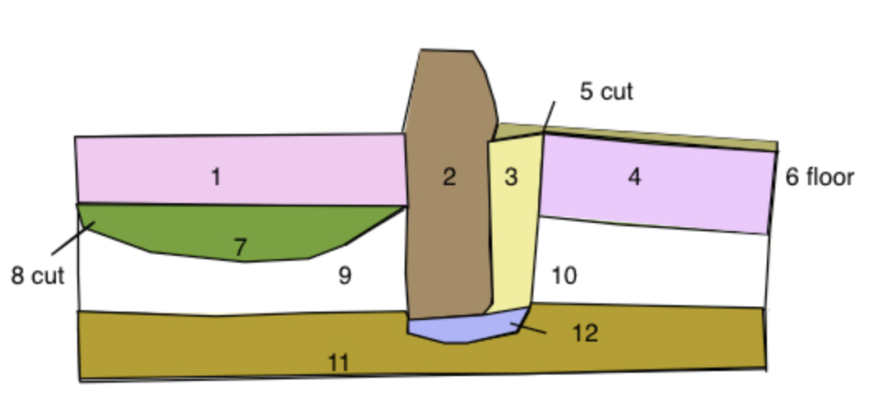

## Stratigraphy & Recording Archaeological Data

When we did our graveyard project field work, you were recording all kinds of metadata and data about the graveyard. No digging involved! When we excavate, we pay that same attention to both the data (our observations) and our metadata (observations about our observations) and our process (our paradata). Designing a recording sheet is a critical intervention because in a very real way, if our recording sheets don't have a spot for the information, _it doesn't exist_. We look for the things that fit into our sheets. 

The same is true when recording what we observe as we dig. There are many ways to do this, and so, there are many ways of seeing like an archaeologist. The way I was trained involved a style called 'single-context recording'. As we're not digging, in this class, we'll only gain a glancing familiarity, but I thought it good to give it a go.

This video explains how these sheets get filled out, and what they record, and why (courtesy the University of Reading's field school at Roman Silchester):

<iframe width="560" height="315" src="https://www.youtube.com/embed/JHHxl5_2Qnk?si=Zf5fkiAzmRxbBIOx" title="YouTube video player" frameborder="0" allow="accelerometer; autoplay; clipboard-write; encrypted-media; gyroscope; picture-in-picture; web-share" referrerpolicy="strict-origin-when-cross-origin" allowfullscreen></iframe>

An excellent resource to book mark is [https://archgoodpractice.com](https://archgoodpractice.com/Introduction/).

## Harris Matrix

Those recording cards, that approach to managing the information generated through excavation is in a very real sense _the_ archaeology; without the records, we've just dug a bunch of stuff up. It's only by considering how all of this data (and if its the _right_ data) interrelates that we can begin to tell the story of the site. So the task then is how to figure out how everything relates in both time and space. Edward C. Harris tried to systematize these relationships in 1973, coming up with a system (nowadays, with modifications) that we call the Harris Matrix. In essence, he recognized that there are ways of reading the stratigraphy - the sequence of layers, deposits, cuts into layers, and fills of layers - that can be untangled such that we can reconstruct the sequence of events that made the site. This video is handy here so please watch:

 

Now it's our turn.

## The Task

I'm going to give you some illustrations; you're going to draw the Harris Matrix and tell me the story or sequence of events. You'll use a tool for this that I have made.

### Exercise 1.

Here is schematic representation of the side of a trench after the archaeologist has dug all the way down to the natural soil (before humans turned up). As the archaeologist dug in 2024 she carefully removed each layer as she encountered it, giving it a number. Notice 2, 3, and 12. These are the _fill_ of a hole - 5 - dug into that first layer of soil 1. Indeed, 2 is a wall and 3 is the packing material shoved into the hole to keep it upright on its foundation 12. Something else to notice about the diagram below is that it uses colour to indicate when a layer is probably the same.

- each number in the diagram is a context
- the modern day is at the top
- the earliest event is at the bottom
- things that lie above are more recent
- things that lie below are older

Items found in the layers:

- 1 - a coin from 1910
- 3 - pottery whose style was produced from 1885 to 1901
- 7 - pottery whose style was produced from 1874 to 1890
- 10 - some brick rubble with a maker's mark for a brick yard in the region active from the 1860s until sometime before the turn of the century
- 11 - some hand-cut nails (made by a blacksmith) in a style that was present regionally from the 1830s to the 1850s

What is the sequence of layers that had to be laid down for the cut vertically through the earth to look like this? Figuring out that sequence is one of the chief ways archaeologists build up knowledge about the past. So: I want you to draw this sequence using the [tool behind this link](https://shawngraham.github.io/homecooked-history/hm-generator-site/enhanced.html) and then tell me the story of this trench. 

The tool interface works like this:

- click on the canvas to make a context
- add whatever metadata you've got
- drag and drop a context ONTO another one and select the nature of the relationship between the two contexts
- click on the 'create' groups button if you think there are any groups of contexts that should go together; then when you click on a context to edit it you can assign it to the appropriate group
- you can do the same thing with phases
- when you're done, click 'Analyze Conflicts' to see if there are any logical snafus in your work
- you can export your work as CSV and lodge it in your github repository
- you can also take a screenshot of your diagram (or export an svg image) and lodge that in your github repo

That was pretty straightforward, eh?

### Exercise 2

Take a look at [this drawing](https://archgoodpractice.com/media/sites/10/2024/03/Illustration_4.jpg). It's rather more complicated that the first one. See if you can devise the Harris Matrix for this section, using my tool. 

Then, you can see what it _ought_ to look like [here](https://archgoodpractice.com/media/sites/10/2024/03/Illustration-3.png). The task for you to answer here is _why?_ 

### Exercise 3

This will be more complicated. In this image, the dating information is more muddied and not completely clear.

Open [this link in a new window](https://www.archaeological.org/archaeodoodles/archaeodoodle-39546/); it's a sketch of an archaeological section by Jona Schlegel. Assign context numbers to the layers or events (remember, digging a hole or removing earth counts!) that you can see. Use my tool again to draw the matrix.

The vase that is visible is of a type that was in use for the first two centuries CE. There's a version very similar that was in production in the second and third centuries, but mostly in the Greek East. The stone block wall might be late fourth century. Or it might be late second. Try to generate the harris matrix that describes what you're seeing. If you're ambitious, you might try to define groups or phases of materials (a group being a series of contexts that are largely part of the same event)

On grouping and phasing see [this](https://archgoodpractice.com/grouping/) and [this](https://archgoodpractice.com/phasing/).

Things to look for when thinking about grouping/phasing, per https://archgoodpractice.com/

+ Shared space (in time) (i.e. a series of pits which were cut at the same time)
+ Shared function (i.e. a cluster of post holes that formed a structure)
+ Identicality or former wholeness (i.e. a single spatiotemporal deposit which was divided by a later truncation, or only excavated in separate segments) 

Remember, I'm not after the *right* answer, but *better* answers, and your *process*. How does making a Harris Matrix constrain or enable your archaeological imagination? Feel free to share your Harris Matrices with classmates.

